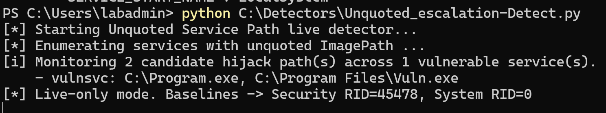
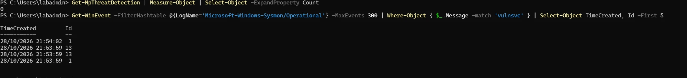

# Technique 2 — Unquoted Service Path

| | |
|---|---|
| **MITRE ATT&CK** | [T1574.009](https://attack.mitre.org/techniques/T1574/009/) — Hijack Execution Flow: Path Interception by Unquoted Path |
| **Tactic** | Privilege Escalation, Persistence, Defense Evasion |
| **Starting point** | A standard user who can write to a folder in the service's path |
| **Result if undetected** | Code running as the service account, often `SYSTEM` |

## What the weakness is

A Windows service has a **path to the program it runs** (its `ImagePath`). If that path
contains **spaces** and is **not wrapped in quotation marks**, Windows has to guess where
the program name ends. It tries each possibility in order, adding `.exe`:

For a service path like `C:\Program Files\My App\service.exe` (no quotes), Windows tries:

1. `C:\Program.exe`
2. `C:\Program Files\My.exe`
3. `C:\Program Files\My App\service.exe` ← the real one

It runs the **first** of these that exists. The real program is last, so if someone can
place a program at one of the **earlier** names, Windows runs *that* instead — as the
service's account, which is usually SYSTEM, every time the service starts.

**From your attacker side:** you listed services, found one with an unquoted path and a
space, and checked whether you could write to an earlier folder in that path. The
weakness is two things lining up: a badly written service entry, and a folder a normal
user is allowed to write into.

## How it looks to a defender

### Signal A — the weak service (the cause)

A service whose `ImagePath` has spaces and no quotes. This can be found by **listing the
services and checking their paths** — a configuration audit, not a live event. It is the
setting that makes the attack possible, so finding it early closes the hole before anyone
uses it.

### Signal B — the hijack binary appearing (the setup)

A **new executable** being written to one of the earlier path names, such as
`C:\Program.exe` or a first-word `.exe` inside `Program Files`. Legitimate software
almost never puts an executable there, so this is a strong signal.

- **Sysmon Event ID 11** (FileCreate) for a `.exe` at one of those locations.

### Signal C — the hijack running (the abuse)

A process starting **from that unusual path**, with its **parent being `services.exe`**
(because Windows' service controller launched it). If the attacker then used the SYSTEM
access to create an account or add someone to a group, those show up too.

- **Security 4688 / Sysmon 1** — process from `C:\Program.exe` (etc.), parent `services.exe`.
- **System 7036** — the service changing to the "running" state around the same time.
- **Security 4720** (new user) / **4732** (added to a privileged group) — common follow-on.

## Detection logic (plain English)

> **Alert — high:** a service has an unquoted `ImagePath` containing a space (the host is exploitable).
>
> **Alert — critical:** a process whose parent is `services.exe` is running from an
> unexpected location such as `C:\Program.exe`.

## Sigma rules

- [`../sigma-rules/02a_unquoted_service_path_binary_planted.yml`](../sigma-rules/02a_unquoted_service_path_binary_planted.yml) — hijack binary appearing (Signal B)
- [`../sigma-rules/02b_unquoted_service_path_exec.yml`](../sigma-rules/02b_unquoted_service_path_exec.yml) — hijack binary running from a service (Signal C)

## Results from the lab (Signal A — the vulnerable service exists)

Tested 2026-10-28 on `WIN-LAB`. A service `vulnsvc` was created with an unquoted path
containing spaces (`C:\Program Files\Vuln App\vulnservice.exe`), running as `LocalSystem`.
Then each defence was checked.

**Scope of this test (precise claims):**
- ✅ Vulnerable configuration found — an unquoted service path with spaces, running as SYSTEM
- ⚠️ Suspicious activity observed — the service creation was logged (not the hijack)
- ❌ Full exploitation demonstrated — **no binary was planted** at the hijack path and the
  service was **not** made to run it, so execution-hijack to SYSTEM was not carried through
- ✅ Detection validated — the 1.0 detector identified the vulnerable service and its hijack paths

| Defence | Detected? | What it showed |
|---|---|---|
| Microsoft Defender | ❌ Miss | `Get-MpThreatDetection` count = 0; Defender does not inspect service configuration |
| Sysmon + community config | ⚠️ Partial | Logged the service creation (Event 1 = the `sc.exe create` command, Event 13 = the service's registry keys) but raised **no alert** — the raw telemetry is present, yet nothing flags the path as unquoted and exploitable |
| My own detector (1.0) | ✅ **Detected** | Enumerated services and flagged `vulnsvc` by name, listing the exact hijack paths: `C:\Program.exe` and `C:\Program Files\Vuln.exe` |

**Finding:** only the purpose-built detector *identified the vulnerability*. Defender
ignored it entirely; Sysmon **captured the activity but didn't flag the risk** — a skilled
analyst could spot the missing quotes by reading the Event 1 command line, but no alert
fired. This is the gap between **logging** and **detecting**. Sigma rules `02a`/`02b`
propose turning Sysmon's raw telemetry into an alert (experimental, not yet validated).

Evidence — the detector flags the vulnerable service and its hijack paths:

Evidence — Defender finds nothing (0); Sysmon logged it (Events 1 and 13) but didn't flag it:

## Analyst playbook (if this alert fires)

1. **Identify the service.** Which service has the unquoted path, and what account does it run as?
2. **Check for a planted binary.** Is there an unexpected `.exe` at an earlier path name?
3. **Check execution.** Did a process run from that path with `services.exe` as its parent?
4. **Contain.** Stop the service, remove the planted binary, and quote the service path.
5. **Prevent.** Audit all services for unquoted paths; this is a one-time sweep that closes many holes.

## Hardening

- Quote every service binary path (`"C:\Program Files\...\service.exe"`).
- Remove write permissions for standard users on folders that sit in a service path.
- Run a periodic audit for unquoted service paths — it is cheap and catches the problem at the source.
