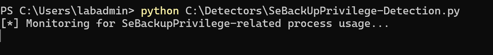
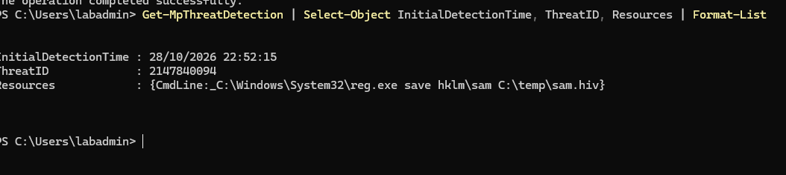
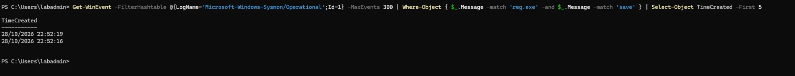

# Technique 3 — Backup-Operator / SeBackupPrivilege Abuse

| | |
|---|---|
| **MITRE ATT&CK** | [T1003.002](https://attack.mitre.org/techniques/T1003/002/) — OS Credential Dumping: SAM |
| **Tactic** | Credential Access (leading to Privilege Escalation) |
| **Starting point** | A non-admin account that holds `SeBackupPrivilege` (e.g. a member of **Backup Operators**) |
| **Result if undetected** | The password-hash database, then admin access elsewhere |

## What the weakness is

`SeBackupPrivilege` is a Windows right meant for **backup software**. It lets an account
read **any file on the system**, ignoring the normal permission checks, so a backup tool
can copy files it would otherwise be blocked from. That is reasonable for a backup
service, but it is dangerous to hand to an ordinary user, because "read any file" includes
the files that hold **Windows' password hashes**:

- `C:\Windows\System32\config\SAM` (the local account hashes)
- `C:\Windows\System32\config\SYSTEM` (the key needed to decode them)

These are normally locked, even to administrators, while Windows is running. With backup
rights, an account can copy them anyway.

**From your attacker side:** you had (or were granted) backup rights, saved the `SAM` and
`SYSTEM` hives, and took the hashes away to crack or reuse. The weakness is a **powerful
privilege given to an account that should not have it** — the privilege, not a software bug.

## How it looks to a defender

### Signal A — the risky privilege assignment (the cause)

An account that holds `SeBackupPrivilege`, or membership of the **Backup Operators**
group, that should not have it. Found by **auditing privileges and group membership** —
a configuration check, not a live event.

### Signal B — the hashes being copied (the abuse)

A tool reading or saving the `SAM` / `SYSTEM` hives from a non-backup context. The most
common and obvious form is `reg.exe save`:

- **Security 4688 / Sysmon 1** — `reg.exe` with a command line containing `save` and
  `hklm\sam`, `hklm\system`, or `hklm\security`.
- Other tools that do the same job: `esentutl.exe`, `diskshadow.exe`, `robocopy` with
  backup mode. Watching for these copying from the `config` folder covers the quieter variants.
- **Security 4673 / 4674** — a privileged service or object operation, which fire when
  the backup privilege is actually exercised.

## Detection logic (plain English)

> **Alert — high:** a non-admin account holds `SeBackupPrivilege` or is in Backup Operators.
>
> **Alert — critical:** a process is saving or copying the `SAM` / `SYSTEM` registry hives.

The hive-copy alert is strong because **nothing in normal day-to-day use saves the SAM
hive**. Real backups use shadow copies through the backup service, not a user running
`reg save` by hand.

## Sigma rules

- [`../sigma-rules/03a_sam_hive_dump_reg.yml`](../sigma-rules/03a_sam_hive_dump_reg.yml) — `reg.exe` saving a password hive (Signal B)
- [`../sigma-rules/03b_sam_hive_copy_backup_tools.yml`](../sigma-rules/03b_sam_hive_copy_backup_tools.yml) — backup tools copying the hives (Signal B, quieter variants)

## Results from the lab (Signal B — SAM/SYSTEM hives dumped)

Tested 2026-10-28 on `WIN-LAB`. With the detector running, `reg save hklm\sam` and
`reg save hklm\system` were run from an admin shell. The SYSTEM save completed; the **SAM
save returned an error, and Defender reported blocking it**.

**Scope of this test (precise claims):**
- ✅ Suspicious activity observed — the `reg save` of credential hives
- ❌ Privilege-escalation path demonstrated — the `reg save` was run from an **administrative**
  shell to generate the telemetry; this is **not** a non-admin Backup Operators account
  escalating, and no hashes were extracted
- ✅ Detection validated — **Defender recorded the SAM save and reported blocking it**; Sysmon
  recorded two matching process events; the polling detector missed them (its documented
  timing limitation)

| Defence | Detected? | What it showed |
|---|---|---|
| Microsoft Defender | ✅ **Detected; reported blocked** | Recorded a detection for `reg.exe save hklm\sam ...` (ThreatID 2147840094) with action *blocked*, and the `reg save hklm\sam` command returned an error at the same moment. Together these indicate the block; the absence of an output file was **not** separately checked. The SYSTEM hive save completed |
| Sysmon + community config | ⚠️ Telemetry, no alert | Two Event 1 (process-create) records matched a search for `reg.exe` + `save`, at the times the two commands were run. The screenshot shows their timestamps, not their full command lines, so each is matched to its hive by timing and order. No alert, which is expected: Sysmon records events, it doesn't alert on them |
| My own detector (1.0) | ❌ Miss | Polls every 3 seconds; `reg.exe` runs in milliseconds, so the process was gone before the next poll. The documented polling limitation, confirmed in the lab |

**Finding:** this technique flips the pattern. Defender is **strong against known malicious
behaviour** — it flagged the SAM dump by its command line and reported blocking it — while it was
blind to the misconfigurations in techniques 1–2. Sysmon's event-driven logging **caught
what the polling detector missed**, which is the clearest possible evidence for the 2.0
improvement: move the detectors from polling to event-driven (ETW/WMI). Sigma rule `03a`
takes the same approach, matching the `reg save` command line in the process-creation event
(experimental; validated against sample events, not yet run in a SIEM).

Evidence — the polling detector missed it (only "Monitoring...", no alert):

Evidence — Defender's detection record for the SAM-save command:

Evidence — two Sysmon Event 1 records at the times of the two reg commands (timestamps shown):

## Analyst playbook (if this alert fires)

1. **Confirm the copy.** Which process saved which hive, under which account?
2. **Check the privilege.** Does that account legitimately need backup rights? Almost always, no.
3. **Assume the hashes are exposed.** If `SAM` + `SYSTEM` left the host, treat every local
   account's password as compromised.
4. **Contain.** Remove the account's backup rights / Backup Operators membership, and reset
   the exposed local account passwords.
5. **Prevent.** Keep `SeBackupPrivilege` and Backup Operators limited to the backup service only.

## Hardening

- Never grant `SeBackupPrivilege` or Backup Operators membership to ordinary users.
- Audit who holds this privilege as a standing check.
- Monitor for `reg save` / hive copies of `SAM`, `SYSTEM`, `SECURITY` — a high-value, low-noise alert.
