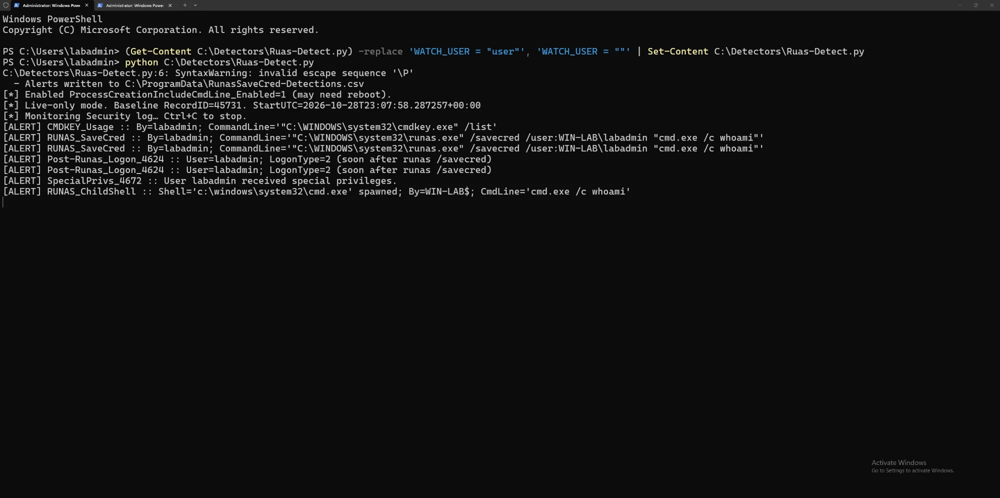
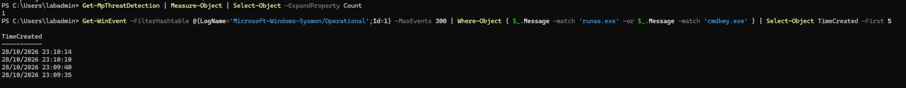

# Technique 4 — Saved-Credential Reuse (cmdkey / runas /savecred)

| | |
|---|---|
| **MITRE ATT&CK** | [T1078](https://attack.mitre.org/techniques/T1078/) — Valid Accounts · [T1555.004](https://attack.mitre.org/techniques/T1555/004/) — Credentials from Windows Credential Manager |
| **Tactic** | Privilege Escalation, Defense Evasion, Credential Access |
| **Starting point** | A standard user on a host where an admin credential was **saved** |
| **Result if undetected** | Commands running as the saved (often admin) account |

## What the weakness is

Windows has a built-in password store, the **Credential Manager**, and a way to save a
credential into it with the `cmdkey` command. Once a credential is saved, the `runas`
command can start a program **as that account without asking for the password again**,
using its `/savecred` option.

This is convenient, but it means: if an administrator ever saved their credential on a
machine, **anyone who later uses that machine** can run programs as that admin without
knowing the password. The saved credential is tied to the machine profile, not to the
person who saved it.

**From your attacker side:** you listed saved credentials (`cmdkey /list`), saw a stored
admin entry, and ran `runas /savecred /user:...` to get a shell as that admin, never
needing the password. The weakness is a **convenience feature leaving an admin credential
reusable** by a lower-privileged user.

## How it looks to a defender

### Signal A — a credential being saved (the cause)

`cmdkey` storing a credential. This is the moment the reusable credential is created.

- **Security 4688 / Sysmon 1** — `cmdkey.exe` with `/add` or `/generic` on its command line.

### Signal B — the saved credential being reused (the abuse)

`runas /savecred` launching a program, and the logon that follows.

- **Security 4688 / Sysmon 1** — `runas.exe` with `/savecred`, and often a child shell
  (`cmd.exe`, `powershell.exe`) whose parent is `runas.exe`.
- **Security 4648** — "logon using explicit credentials", which fires when one account
  runs something as another. A standard user triggering 4648 for an admin account is the
  tell-tale.
- **Security 4624** (a new logon) and **4672** (special privileges assigned) shortly after,
  for the admin account.

Watching 4648 **correlated** with a `runas /savecred` process is what separates abuse from
noise. My 1.0 detector moves in this direction, but only partly. See the correlation note under
the lab results.

## Detection logic (plain English)

> **Alert — medium:** `cmdkey` is saving a credential (a reusable credential is being created).
>
> **Alert — high:** `runas /savecred` is used, especially by a standard user to run as an admin,
> followed by an explicit-credential logon (4648) for that admin.

## Sigma rules

- [`../sigma-rules/04a_runas_savecred.yml`](../sigma-rules/04a_runas_savecred.yml) — a saved credential being reused (Signal B)
- [`../sigma-rules/04b_cmdkey_credential_store.yml`](../sigma-rules/04b_cmdkey_credential_store.yml) — a credential being saved (Signal A)

## Results from the lab (saved-credential reuse)

Tested 2026-10-28 on `WIN-LAB`. With the detector running, `cmdkey /list` and
`runas /savecred /user:WIN-LAB\labadmin "cmd.exe /c whoami"` were run (the second succeeded,
spawning a shell as labadmin).

**Scope of this test (precise claims):**
- ✅ Suspicious activity observed — `cmdkey` and `runas /savecred`, and the resulting logon
- ⚠️ Privilege-escalation path demonstrated — `runas /savecred` ran a command as `labadmin`,
  but this was **not** a clean standard-user → administrator transition using a credential a
  standard user should not have had; it shows the technique's footprint, not a full escalation
- ✅ Detection validated — the 1.0 detector raised an alert for each step (cmdkey, runas, logon,
  privileges, child shell); only the logon alert was linked to the runas, and only by timing (see note)

| Defence | Detected? | What it showed |
|---|---|---|
| Microsoft Defender | ❌ Miss | `Get-MpThreatDetection` listed only the earlier SAM dump (22:52, technique 3); nothing for cmdkey/runas (23:09–23:10). Defender treats these built-in admin tools as legitimate |
| Sysmon + community config | ⚠️ Partial | Logged the `runas.exe` and `cmdkey.exe` processes (four Event 1s) but raised **no alert** |
| My own detector (1.0) | ✅ **Detected** | Raised an alert for each step: `CMDKEY_Usage`, `RUNAS_SaveCred` (both attempts), `Post-Runas_Logon_4624`, `SpecialPrivs_4672`, and `RUNAS_ChildShell`. These are separate alerts; only `Post-Runas_Logon_4624` is linked to the runas, by timing. It reads the persisted Security log, where records stay after the process exits, so short-lived activity isn't missed between checks |

**Finding:** the detector's strongest result. It alerted on **every step** of the technique: the
saved-credential reuse, the resulting logon, the elevated privileges and the spawned shell. It
caught everything because it reads the **persisted event log** rather than the live process list,
the direct contrast to technique 3's polling miss.

> **Correlation note (precise claim):** at the time of this test the alerts were *not* joined into
> one linked incident. The only link was `Post-Runas_Logon_4624`, which fired for an interactive
> logon within 180 seconds of *any* runas, so it could also fire for an unrelated user. After an
> external code review this was tightened: the logon must now be for the same account and domain
> the runas targeted, timed on the events' own timestamps. That is stronger, but still not a hard
> link (it doesn't match a logon ID or SID), and the fixed version has not been re-run in the lab.

Defender saw nothing (legit tools), and Sysmon had the telemetry but, as a logging tool, raised no alert. Sigma rules `04a`/`04b`
propose alerts on that telemetry (experimental; `04a` is validated against sample events,
`04b` is not yet, and neither has been run in a SIEM).

> A verification note worth keeping: Defender's threat count showed `1`, which looked like a
> technique-4 hit — but checking the detail showed it was the leftover SAM-dump detection from
> technique 3. Always confirm what a count actually is before reporting it.

Evidence — the detector alerts on each step of the chain:

Evidence — Defender's only hit is the old SAM dump; Sysmon logged the processes:

## Analyst playbook (if this alert fires)

1. **Confirm the reuse.** Which account ran `runas /savecred`, and as which account?
2. **Find the saved credential.** Check Credential Manager on the host for stored admin entries.
3. **Judge the risk.** A standard user running commands as an admin via a saved credential is
   effectively a privilege escalation; treat the admin account as exposed on that host.
4. **Contain.** Remove the saved credential (`cmdkey /delete`), and review what was run as the admin.
5. **Prevent.** Discourage saving privileged credentials; use just-in-time admin access instead.

## Hardening

- Do not save administrator credentials with `cmdkey` on shared or standard-user machines.
- Audit Credential Manager for stored privileged credentials.
- Monitor `cmdkey /add` and `runas /savecred`, and correlate with 4648 explicit-credential logons.
